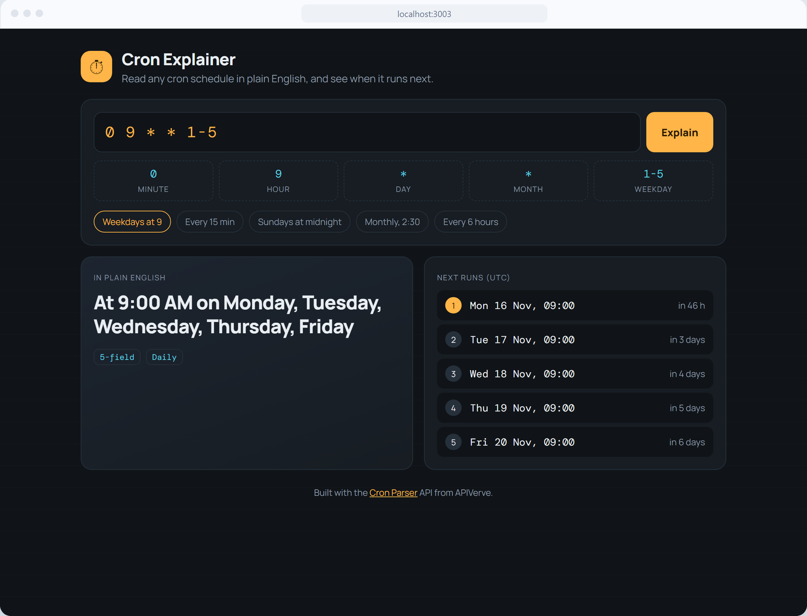

# Cron Explainer | APIVerve Template

[](LICENSE)
[](package.json)
[](tsconfig.json)
[](https://apiverve.com/marketplace/cronparser?utm_source=github&utm_medium=template&utm_campaign=cron-explainer-nextjs-tutorial)

A cron explainer you can deploy in one click. Type a cron expression and read it in plain English, see each field labelled, and get the next five times it will run. Presets cover the common schedules, and a link like `?expression=*/15 * * * *` opens on any expression.

[](https://vercel.com/new/clone?repository-url=https%3A%2F%2Fgithub.com%2Fapiverve%2Fcron-explainer-nextjs-tutorial&project-name=cron-explainer&repository-name=cron-explainer&env=APIVERVE_API_KEY&envDescription=Your%20APIVerve%20API%20key.%20Free%20to%20create%2C%20no%20card%20needed.&envLink=https%3A%2F%2Fdashboard.apiverve.com%2Fsignup%3Fapi%3Dcronparser%26utm_source%3Dvercel%26utm_medium%3Dtemplate%26utm_campaign%3Dcron-explainer-nextjs-tutorial)



---

### Get your free API key

This template needs an APIVerve API key. **[Sign up free](https://dashboard.apiverve.com/signup?api=cronparser&utm_source=github&utm_medium=template&utm_campaign=cron-explainer-nextjs-tutorial)**, no credit card required.

---

## Deploy in one click

Click **Deploy with Vercel** above. Vercel copies this repo to your GitHub account, asks for your `APIVERVE_API_KEY`, and gives you a live URL about a minute later.

## Run it locally

```bash
git clone https://github.com/apiverve/cron-explainer-nextjs-tutorial.git
cd cron-explainer-nextjs-tutorial
npm install
cp .env.example .env   # then set APIVERVE_API_KEY in .env
npm run dev
```

Open `http://localhost:3000`. To see it in a phone and a browser frame side by side, open `http://localhost:3000/showcase.html`.

## How it works

1. `components/CronApp.tsx` is the page. It calls `/api/explain?expression=...` when you press Explain or pick a preset.
2. `app/api/explain/route.ts` checks the input, then calls Cron Parser. Your API key stays on the server and never reaches the browser. Answers are cached for a minute, since the next run times move on, and cached answers don't count against the rate limit.
3. The page labels each field of the expression, shows the sentence the API returns, and lists the next runs in UTC with how far away each one is.

Everything on the page works on a free key: the plain-English description, the format and the next five runs. Paid plans add a per-field breakdown and the schedule's frequency type, which the page shows as a tag when present.

```
app/
  api/explain/route.ts   checks the field count, then calls Cron Parser
  layout.tsx
  page.tsx
  globals.css
components/
  CronApp.tsx            the page
lib/
  apiverve.ts            key, rate limit and cache helpers
public/
  showcase.html          phone and desktop demo frame
```

### The API call

```ts
const res = await fetch('https://api.apiverve.com/v1/cronparser?expression=' + encodeURIComponent('0 9 * * 1-5'), {
  headers: { 'x-api-key': process.env.APIVERVE_API_KEY! }
});
const { data } = await res.json(); // data.description, data.nextRuns
```

## Before you share your URL

Once deployed, anyone who finds your URL can use it on your API key. Each visitor can make 10 uncached requests a minute, and repeat lookups come from the cache, which is fine for a demo. Both are kept in memory, so they aren't shared between serverless instances. For production:

- Put the page behind your own sign-in, or
- Move the limit and cache to a shared store such as [Upstash Redis](https://upstash.com/), or
- Call the route only from your own backend.

## Ideas to extend it

- Go the other way and build expressions from a form with [Cron Generator](https://apiverve.com/marketplace/crongenerator).
- Show the next runs in each teammate's timezone with [World Time](https://apiverve.com/marketplace/worldtime).
- Skip weekends and holidays when planning jobs with [Working Days](https://apiverve.com/marketplace/workingdays).

## API reference

- [Cron Parser](https://apiverve.com/marketplace/cronparser?utm_source=github&utm_medium=template&utm_campaign=cron-explainer-nextjs-tutorial): `GET https://api.apiverve.com/v1/cronparser`
- [Full documentation](https://docs.apiverve.com?utm_source=github&utm_medium=template&utm_campaign=cron-explainer-nextjs-tutorial)

## Tech stack

- **Next.js 16** (App Router) and **React 19**, in **TypeScript**
- A **Route Handler** in `app/api/` for the server side, so the key never reaches the browser
- Deploys to Vercel as-is, with no configuration

## License

MIT. See [LICENSE](LICENSE).
